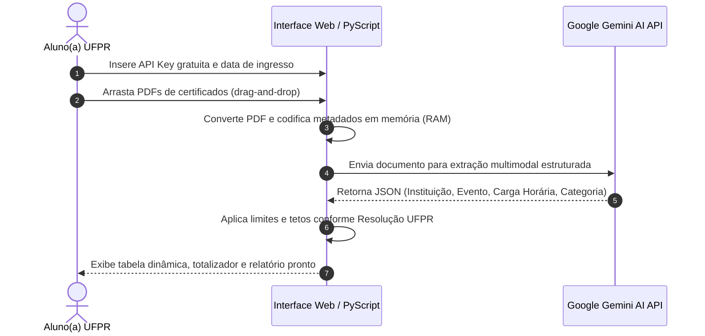

# 🎓 Gestor Inteligente de Horas Formativas UFPR
### Assistente Automatizado de Análise de Certificados com Inteligência Artificial

**Validação, Enquadramento Normativo e Contabilização Curricular 100% no Navegador**

[-brightgreen)](#-privacidade-e-conformidade-lgpd)

---

## 📌 Visão Geral

O cumprimento das **Atividades Formativas (Horas Complementares)** é requisito obrigatório para a colação de grau na Universidade Federal do Paraná (UFPR). No entanto, o processo manual de calcular cargas horárias, enquadrar certificados nas dezenas de categorias da resolução e controlar tetos de horas é moroso e sujeito a erros.

O **Gestor de Horas Formativas** resolve esse gargalo ao unir **Python no Navegador (PyScript)** e a **API Multimodal Google Gemini**. A ferramenta lê certificados digitais em lote diretamente no navegador do estudante, identifica os dados essenciais e gera o quadro consolidado de integralização em segundos.

---

## 🚀 Como Funciona o Fluxo Inteligente

---

## ✨ Funcionalidades em Destaque

- **🤖 OCR e Extração Multimodal via LLM:** Não depende de layouts pré-fixados. A IA interpreta diplomas, certificados de congressos, cursos livres, bolsas e monitorias.
- **⚖️ Enquadramento Automático na Resolução UFPR:** Alocação dos certificados nos grupos corretos de atividades com respeito aos tetos máximos permitidos por categoria.
- **⚡ Arquitetura Serverless (Zero Backend):** Graças ao **PyScript**, a lógica Python roda localmente na máquina do usuário via WebAssembly.
- **📊 Totalizador Dinâmico:** Atualização instantânea da barra de progresso da meta de horas exigidas pelo curso.
- **📋 Exportação Limpa:** Tabela detalhada com nome do evento, emissor, data de realização e carga horária validada.

---

## 🔒 Privacidade e Conformidade LGPD

Diferente de plataformas em nuvem que armazenam documentos de terceiros:
1. **Nenhum PDF é salvo em servidor:** O arquivo é processado apenas na memória volátil do navegador.
2. **Chave de API Pessoal:** O estudante utiliza sua própria chave gratuita do Google AI Studio, sem intermediários.
3. **Em Conformidade com a LGPD:** Respeito integral à privacidade dos dados de identificação do discente (matrícula, CPF e histórico).

---

## 🛠️ Tecnologias Utilizadas

- **PyScript (Python 3 via WebAssembly):** Processamento assíncrono e lógica de negócio em Python diretamente no client-side.
- **Google Gemini API:** Modelo fundacional para interpretação semântica de documentos não estruturados.
- **HTML5 & CSS3 Responsivo:** Design limpo, focado em usabilidade e acessibilidade com suporte a tema escuro/claro.
- **AsyncIO & JavaScript Bridge:** Comunicação fluida entre a camada DOM do navegador e as rotinas Python.

---

## 💻 Instruções de Uso

1. Obtenha uma chave gratuita da API Gemini no [Google AI Studio](https://aistudio.google.com/app/apikey).
2. Acesse a aplicação hospedada no GitHub Pages:
   👉 **[brunomarafiga.github.io/horas_formativas_UFPR](https://brunomarafiga.github.io/horas_formativas_UFPR/)**
3. Clique em **Configurações**, cole sua chave de API e selecione o ano/mês de ingresso na UFPR.
4. Arraste os certificados em PDF para a área de upload e aguarde o processamento automático.
5. Verifique o resumo de horas e imprima ou salve o resultado para submissão à coordenação de curso!

---

Desenvolvido por <strong>Bruno Marafiga</strong> 
Curso de Gestão da Informação • Universidade Federal do Paraná (UFPR)

